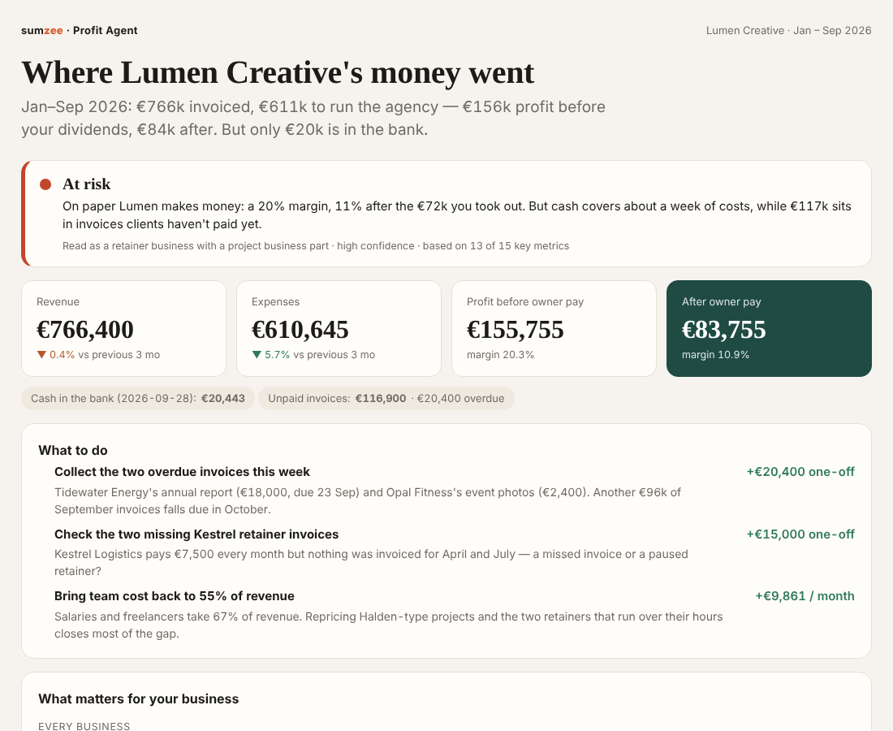

# Where did your agency's money go?

**Two free Claude skills for agency and service-business owners, from [Sumzee](https://www.sumzee.co).**

Revenue grows, but the bank balance doesn't. The P&L looks fine while one client quietly loses money. Reporting takes hours, and nobody agrees which numbers are right.

These skills give you a straight answer from the spreadsheets you already have — in about 15 minutes, inside your own Claude account.



*A real run on a fictional 15-person agency. [Open the full dashboard](examples/lumen-creative/output/profit-dashboard.html).*

## What's inside

| Skill | What you give it | What you get |
| --- | --- | --- |
| **Profit Agent** | Whatever you track money in: bank export, invoice list, expense sheet, P&L, timesheet. Messy is fine. | A one-page dashboard: healthy / needs attention / at risk, profit before and after you pay yourself, metrics for *your* business model against clear norms, and 2–3 actions with a euro effect ("collect two overdue invoices → +€20,400"). |
| **System Builder** | A short interview, plus your spreadsheets if you have them. | Your finance and operations system drawn as a schema, then built in your own Airtable with your history moved in — clients, projects, payments, costs. |

Start with the Profit Agent. It shows what you can see today and what data is missing; the System Builder then sets up a place to collect it.

## Install

**In the Claude app (claude.ai, desktop or mobile)** — no code needed

1. Download the zip: [Profit Agent](https://github.com/Sumzee/agency-finance-skills/raw/main/dist/sumzee-profit-agent.zip) · [System Builder](https://github.com/Sumzee/agency-finance-skills/raw/main/dist/sumzee-system-builder.zip) — or get both at [sumzee.co/skills](https://www.sumzee.co/skills).
2. In Claude: **Customize → Skills → upload** the zip, as is (don't unzip it).
3. Make sure code execution is on, then say *"Here are my finance files — how much are we actually making?"* and attach them.

Step-by-step guides with screenshots are inside each zip (`00_READ-ME-BEFORE-YOU-START_all-instructions.html`), in English and Russian.

**In Claude Code**

```
/plugin marketplace add Sumzee/agency-finance-skills
/plugin install agency-finance@sumzee
```

The System Builder needs the Airtable connector (with access to a whole workspace) for the build step; everything before that works without it.

## Try it without your own numbers

[Download the sample agency](https://github.com/Sumzee/agency-finance-skills/raw/main/dist/sumzee-sample-agency.zip): nine months of invented data for a 15-person agency — an invoice export, a bank export and a timesheet ([browse the files](examples/lumen-creative/data)). Attach the three files and ask the Profit Agent what's going on. (Spoiler: €156k profit, €20k in the bank.)

## Your data stays yours

- The analysis runs inside your own Claude conversation. Sumzee never receives your files.
- Every number on the dashboard is computed by code, not estimated by the AI.
- The optional "Did this get it right?" box shares only your ratings — no amounts, no client names.
- The result is a management view, not accounting or tax advice.

## Want it finished for you?

The skills get you a first version. Sumzee sets up the rest for 10–30 person agencies: team forms, bank imports, one live dashboard across clients, projects, entities and currencies, and a 6-week cash forecast. First version on sample data within 48 hours.

**[Book a 30-minute call](https://calendly.com/gpbalon/30min?utm_source=github&utm_campaign=readme)** · [sumzee.co](https://www.sumzee.co)

## Questions and feedback

Open an [issue](../../issues) or write to gpbalon@gmail.com — questions, bugs and "it got my business wrong" are all welcome.

MIT licensed. Built from two real systems: an agency with projects across several entities and currencies, and a subscription-based choir.
